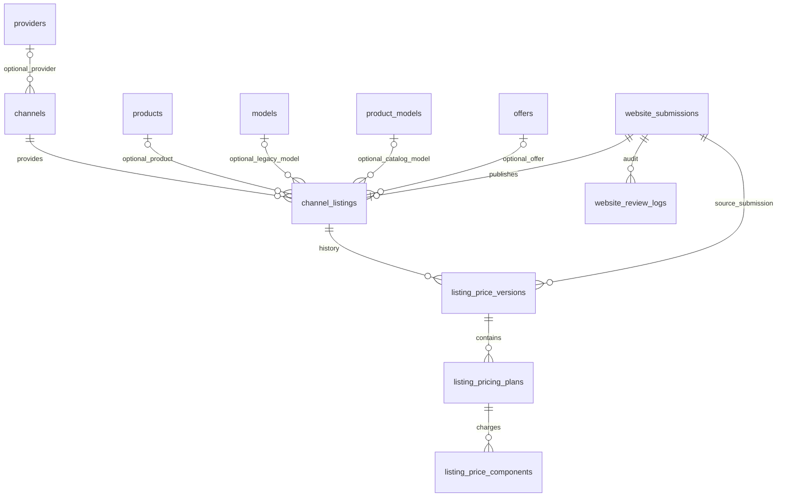

# 官方 / 第三方报价与开发者网站提交

版本：v1.0.0

日期：2026-11-13 UTC

范围：D1 增量结构、网站提交、管理员编辑审核、版本化发布与公开报价页。保留原架构、UI 和计算器。

## 1. 页面与操作

- `/zh/submit/website`、`/en/submit/website`：开发者提交网站、分类、渠道关系、价格来源、联系邮箱，可填写多个套餐和计价组件，也可先只提交网站。
- `/zh/admin`、`/en/admin`：使用现有 `ADMIN_KEY` 加载审核列表、查看原始提交、编辑草稿、标记待补充、拒绝、核对后发布，以及再次编辑并发布更正价格。
- `/zh/websites`、`/en/websites`：公开已审核的渠道、套餐、原币种价格、计价单位、积分与限制；按分类和渠道类型筛选，不混排不同计量单位。
- 原提交页增加网站提交入口，保留原本地价格预览，并明确其结果未发送到审核队列；AI 工具导航增加“网站与渠道报价”。

管理员密钥仅保存在页面组件内存，不写 localStorage、URL 或提交内容。公共接口不返回提交者邮箱、审核备注或原始私有提交。当前使用共享管理员密钥，日志 actor 为 administrator；尚未实现多管理员账户身份。

## 2. 数据关系



`channel_listings.active_version_id` 选择公开版本。渠道分别标识 official（官方）、third_party（第三方）、independent（独立开发者产品）。此标识由管理员审核确认，提交者选择不会直接生效，也不等于自动完成网站所有权验证。

产品、模型、服务渠道不合并为同一个实体。同一模型可以关联多个渠道，一个渠道可以有多个列表及套餐。当前管理表单不按名称自动绑定旧产品/模型；未确定的关联字段保留 NULL。模型名称只描述适用条件，不声称已建立标准模型身份。

## 3. 复用与兼容

复用现有 providers、products、models、product_models、offers 作为可选身份关联，保留原目录来源、价格历史和发布接口。

旧 `pricing_plans` / `pricing_components` 使用 REAL 且服务于现有目录快照。本次通过独立、不可变的渠道报价版本和十进制 TEXT 字段增量扩展，避免把管理员录入的精确金额强转浮点或覆盖旧历史。现阶段旧目录与渠道报价是明确分开的发布域：不会把旧价格批量复制并伪标为新核对价格，也不会自动改写计算器本地档案。

后续产品详情、比较和平替接入时，应通过 Repository 统一读取两个发布域并显式处理单位/身份映射。当前新报价已在独立的“网站与渠道报价”页面公开，尚未接入原 Mock 工具列表或全站价格排序。本次不包含每日价格自动采集。

## 4. 字段字典

金额/额度字段的 `NULL` 代表未知；`0` 必须明确填写。金额和数量按十进制文本校验（最多 30 位数字、12 位小数），不使用浮点计算形成新报价。UTC 时间保存为 ISO 文本。

### channels

| 字段 | 含义 |
| --- | --- |
| id | 渠道主键 |
| provider_id | 可选 providers 外键；身份明确后关联 |
| name | 渠道或网站名称 |
| website | HTTPS 网站地址 |
| relationship | official / third_party / independent |
| created_at | 创建时间 |

### channel_listings

| 字段 | 含义 |
| --- | --- |
| id / channel_id | 列表主键 / 渠道外键 |
| product_id | 可选产品外键 |
| model_id | 可选旧 models 外键 |
| product_model_id | 可选目录 product_models 外键 |
| offer_id | 可选现有 offer 外键 |
| category | image / video / voice / music / llm-api |
| active_version_id | 当前公开价格版本外键；未发布为 NULL |
| created_at | 创建时间 |

### website_submissions

| 字段 | 含义 |
| --- | --- |
| id | 客户端 UUID，请求幂等键 |
| original_json | 规范化原始提交，禁止更新；包含网站描述、来源、套餐和组件 |
| draft_json | 管理员可编辑的审核草稿 |
| contact_email | 私有联系邮箱，保留原值，不公开 |
| status | pending / changes_requested / approved / rejected |
| version | 乐观锁，任何审核修改后递增 |
| listing_id | 发布后绑定列表；唯一且可空 |
| admin_notes | 私有审核备注 |
| created_at / updated_at | 提交 / 最近审核修改时间 |

### listing_price_versions

| 字段 | 含义 |
| --- | --- |
| id / listing_id / submission_id | 价格版本主键、列表和提交外键 |
| revision | 本次审核基础版本号，不要求连续 |
| public_json | 可公开内容快照，白名单字段，无联系邮箱和审核备注 |
| verified_at | 管理员本次核对确认时间；不是厂商生效时间 |
| created_at | 发布记录时间 |

`public_json` 是不可变页面发布快照；套餐与组件同时拆分成关联表用于后续查询，不能只依赖 JSON 搜索核心价格字段。

### listing_pricing_plans

| 字段 | 含义 |
| --- | --- |
| id / version_id | 套餐版本主键 / 发布版本外键 |
| name / currency | 套餐名称 / 原始三位币种代码 |
| amount_decimal | 实际购买报价文本，未知为 NULL |
| billing_cycle | free / monthly / annual / usage / package / one-time |
| pricing_models | 多选付费方式 JSON 数组，可同时为 monthly、credit-based 等 |
| source_url | 该套餐价格来源 HTTPS URL，发布快照保留原地址 |
| free_allowance | 厂商免费额度及有效期说明 |
| restrictions | 限制、超额条件及商用条款说明 |
| credit_pool | 积分池标识，不同池不假定通用 |
| credit_amount_decimal | 套餐积分量文本，可空 |
| stackable | 1 / 0 / NULL（可以 / 不可以 / 未知） |

### listing_price_components

| 字段 | 含义 |
| --- | --- |
| id / plan_id | 组件主键 / 套餐外键 |
| unit | 与计算器一致的 14 种单位之一，并检查分类兼容性 |
| rate_decimal | 每个所选计价单位的现金价格文本，可空 |
| included_decimal | 明确的免费计量数量，可空；Token 为实际 Token 数，不是 1K/1M 块数 |
| overage_decimal | 每个所选单位的超额现金价格，可空；填写时必须提供额度 |
| credits_per_unit_decimal | 每单位积分消耗，正数文本，可空，不与现金单价混淆 |
| model_name | 描述性模型名称，不是自动身份关联 |
| resolution / quality | 适用分辨率 / 质量 |
| duration_seconds_decimal | 规则适用时长，正数秒，可空 |

本次负责结构化录入和展示，不将所有声明自动转成可计算规则。阶梯、复杂生效窗口、最小消费等未结构化条件应记录在限制中；后续比较时无法适配的方案必须阻止计算，不能忽略限制并声称更便宜。

### website_review_logs

| 字段 | 含义 |
| --- | --- |
| id / submission_id | 审核事件主键 / 提交外键 |
| base_version | 审核开始所基于的提交版本 |
| action | save / request_changes / reject / publish |
| actor | 当前为共享密钥管理员 administrator |
| notes | 私有审核备注 |
| snapshot_json | 本次审核草稿的结构化快照 |
| created_at | 操作时间 |

### website_submission_limits

| 字段 | 含义 |
| --- | --- |
| bucket | 来源 IP 与 UTC 小时组合的 SHA-256 摘要；无 Cloudflare IP 时本地环境共享 local 桶 |
| count | 每小时新提交数量，1—5；相同幂等重试不重复消耗 |
| expires_at | 清理时间，两小时后到期，下次提交时清理 |

不保留原始 IP；该节流是当前提交接口的基础控制，并非账户配额。生产跨来源滥用防护可另行配置，不影响当前审核隔离。

## 5. 约束、索引与发布一致性

- D1 外键连接渠道、列表、版本、套餐与组件；分类、状态及渠道类型有 CHECK。
- 提交主键用于幂等：同请求、同内容重试返回已收到；同 ID 内容变化返回冲突。
- 列表 + revision 唯一，提交 + 审核基础版本唯一，提交 listing_id 唯一。
- 审核日志插入触发器检查提交当前 version，防止两个管理员标签页同时覆盖。并发冲突返回 409，应重新加载。
- 原始提交、邮箱和创建时间禁止更新；已发布版本、套餐和组件禁止更新/删除。更正必须发布新版本，旧版保留。
- 审核日志、渠道/列表、价格版本、套餐组件和状态通过 D1 batch 一次事务提交。任一步失败保留原公开价格，不留下半套数据。
- 索引覆盖审核状态与时间、分类与当前版本、模型/产品与渠道、历史时间、套餐版本、组件套餐、节流过期清理。
- TEXT 金额由共享 TypeScript 十进制校验严格检查；数据库不会自行解释任意 TEXT 为有效数字。只能经校验服务写入。

## 6. 流程与校验

开发者提交 → pending → 管理员编辑并保存草稿 → 核对来源与计价条件 → 明确勾选确认 → 发布为 approved。

- 保存草稿不影响公开版本；允许没有完整价格的初始提交。
- 要求补充或拒绝必须有审核备注，不公开、不自动发送邮件。
- 发布至少需要一个有明确价格的套餐。免费必须显式 0，月付/年付/整包/一次性需购买金额，积分方案需明确积分量及积分池。
- 套餐同时支持多种付费方式，购买周期与付费方式必须一致。每套餐最多 30 个组件、每提交最多 10 个套餐，总组件最多 60，以控制一次 D1 batch 规模。
- 分类与单位校验：图片和 Token 不混用，视频时长与音乐时长保留单位，不自动进行价格排序。
- 管理员可直接修改草稿中的网站、渠道关系、价格、币种、套餐、来源、额度及限制。
- 已发布提交可再次保存草稿、重新发布；不允许通过“拒绝”去隐式撤销旧价格。目前没有撤销已发布列表或自助账户入口。
- API 只存储及展示提交 URL，不会由后端抓取用户提交的网址。只接受公开 HTTPS 格式，拒绝凭据、IP 地址、本地地址及非 HTTPS 协议。
- JSON 请求最大 64 KB。公开写接口只能新增待审提交，管理读取和所有审核操作需要有效密钥；示例密钥被拒绝。

## 7. API

| 方法与路径 | 权限 | 行为 |
| --- | --- | --- |
| POST `/api/websites/submissions` | 公开 | requestId、draft、contactEmail、consent；保存待审 |
| GET `/api/websites` | 公开 | 最多 200 条已发布列表及当前价格快照 |
| GET `/api/websites/admin/submissions` | X-Admin-Key | 最近 200 条审核记录 |
| GET `/api/websites/admin/submissions/:id` | X-Admin-Key | 原文、草稿、私有联系信息、审核历史 |
| PUT `/api/websites/admin/submissions/:id` | X-Admin-Key | version、action、draft、notes、confirmed |

发布 action 为 publish，必须 confirmed=true。缺少 Migration 时明确返回 503 和初始化说明，不用本地假数据冒充提交成功。界面只在服务确实保存后显示编号。

## 8. Migration 与本地核对

SQL：`migrations/0005_channel_prices_and_developer_submissions.sql`。新增 8 张表，不删除或改写旧业务表，不自动为含糊的渠道/模型建立关联，不填入虚构报价。

本次先用 SQLite backup 备份项目本地 D1 至 `/tmp/openpricehub-before-0005.sqlite`，再运行 `npm run db:migrate`（仅 --local）。0005 已登记；远程 D1 未操作。部署前需要对真实绑定及远程 schema 单独核查，不能把本地通过等同于生产完成。

迁移前后逐行核对：platforms 3、plans 4、models 6、rules 6、submissions 0、products 10、pricing_plans 19、catalog_revisions 6，完全一致。外键检查通过，项目本地库新提交数量为 0。端到端模拟提交只写入 `/tmp/oph-website-e2e-state`，不污染项目本地报价。

## 9. 验证

本次结果：237 项自动化测试通过（11 个文件，其中新增 13 项网站提交集成测试）；类型检查和生产构建通过。新增网站提交浏览器检查 44 组、首页回归 44 组、完整计算器回归 62 组，共 150 组通过，中英文及桌面/手机均无页面 JavaScript 异常。

浏览器另模拟禁用 randomUUID，确认公网 HTTP 开发环境仍可生成提交幂等 ID。ID 由 getRandomValues 生成，不依赖安全上下文限定的 randomUUID。

自动化测试包括真实 SQLite 事务适配的 API 集成：权限、待审隔离、编辑发布、精确小数、原文不可修改、历史不可覆盖、版本冲突、事务失败回滚、重复提交、审核理由、五类产品、空价与免费、积分池、请求限流和大小限制。

浏览器脚本 `scripts/website-submission-check.mjs` 使用真实本地 Worker + 独立 D1，覆盖中文/英文、1440/390 px，检查提交、未审核不可见、错误密钥、保存草稿、发布后可见、精确金额、邮箱不公开、分类/渠道筛选及移动端宽度。

复现先为独立临时状态应用 Migration：

```bash
./node_modules/.bin/wrangler d1 migrations apply ai-price-compare --local --persist-to /tmp/oph-website-e2e-state
./node_modules/.bin/wrangler dev --local --ip 127.0.0.1 --port 8788 --persist-to /tmp/oph-website-e2e-state --var ADMIN_KEY:website-e2e-test-key
# 另一个终端，前端服务已在 3001 启动：
PLAYWRIGHT_MODULE=/path/to/playwright/index.mjs node scripts/website-submission-check.mjs
```

测试脚本只允许 API 目标为 127.0.0.1，默认使用公开标明的测试密钥，不读取生产密钥。反复运行可能触发临时库的每小时提交上限；使用新的临时状态目录及对应的本地 Worker 即可，不能对生产解除限制以跑测试。

## 10. 未覆盖范围

本次没有迁移生产 D1、部署、自动发送邮件、验证域名所有权、建立开发者账户或启用自动价格采集。原产品详情/比较/平替路由的接入仍按动态更新方案后续执行；当前交付的是可独立使用的网站提交、审核和渠道报价流程。
