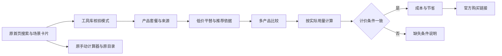
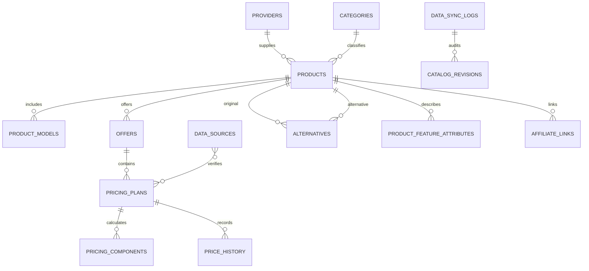

> 本轮界面接入已按用户要求撤回。以下为历史实施记录，不代表当前运行界面。

# 保留原架构与 UI 的增量优化

## 1. 当前结构与保留约束

前端：React/Vite、Locale/Currency/Compare Provider、原 Layout 与 Home/Tools/Submit/ManualCompareWorkspace。旧详情、比较、后台为 Soon 占位。组件：ScenarioCard、ToolCard、SearchBar、侧栏/移动抽屉、卡片/表格切换、CompareBar、BottomNav。原手动工作区含快速/详细计算、本地保存、导入导出，必须不变。

数据：原目录是 mock 数据；新增 catalog 模块已有套餐级计费、核验来源、定向平替、成本规则和 API，但尚未接入。数据库旧 platforms/plans/models/rules/submissions 与 0003/0004 增量目录并存。

## 2. 整改清单

- 保留：原 Logo、字体、颜色、圆角、页宽、顶部导航及下拉、底部导航、首页分区与卡片风格、手动计算器和本地存储。
- 原位优化：首页 slogan、搜索提示、四类场景、真实核验数据、平替和分类计算入口；目录增加套餐筛选，保留卡片/表格切换与侧栏/移动抽屉。
- 兼容：LLM/API 与原人群/地区等筛选保留在原目录的示例数据模式，明确历史示例标签，不能把原热度/示例报价当作核验事实。
- 接入已有模块：产品详情、平替、比较、四类计算器、审核后台、SEO。直接复用已有计算规则与增量表，不另建一套。
- 数据库字段：现有增量表已覆盖需求，本轮无必要新增字段。套餐 pricing_models；component 单位/用量/配额/超额；alternative 定向两端、功能交集、依据、核验状态与时间。未核验的地区/人群属性不推造。

## 3. Sitemap

保留 `/zh`、`/en` 首页和 `/tools`、`/calculator`、`/manual-compare`、`/submit`、`/guides`；支持无前缀新增页面和 `/zh`/`/en` 等价路径。

新增接入：`/tools/:slug`、`/category/ai-image|ai-video|ai-voice|ai-music`（ai-tts 别名）、`/pricing/:model`、`/alternatives`、`/alternatives/:slug`、`/compare`、`/compare/:a-vs-b`、`/calculator/image|video|voice|music`、`/admin`。示例筛选组合、后台、任意组合不进入 sitemap。

## 4. UI 接入规范

保留 Home 的居中 Hero、原 ScenarioCard、计算器横幅、分组卡片、比较链接、更新列表、投稿和指南区域。不接入此前的 CatalogHome，不替换 Layout。四类扩展复用原场景色体系。核验产品卡使用原 ToolCard 的结构/按钮/边框与字号；不把不同计价单位压缩成统一月费。目录继续使用侧栏和移动抽屉，桌面默认表格并可切换卡片。新详情/比较/计算页使用既有 card/input/chip/btn 样式。

## 5—7. 实施与验证记录

实施后记录本轮实际测试和已知数据覆盖；不得以此前结果替代本轮检查。

### 2026-11-04 实施结果

| 阶段 | 本轮交付 | 验证 |
|---|---|---|
| 1—3 检查与规划 | 完成当前结构、保留边界、整改清单、Sitemap、操作流程和关系图；复用已存在增量结构 | 对照 Git HEAD、实际路由与迁移文件，无需新增表或回滚数据 |
| 4 原 UI 增量接入 | Layout 只新增 5 行导航/页脚入口；保留原 Logo、字体、背景、卡片、横幅、页宽；四类 ScenarioCard 和核验 ProductCard 沿用原组件结构 | 桌面/移动截图检查；原底栏和三个手动工作区文件无差异 |
| 5 核心能力 | 原首页接入核验搜索、分类、平替和计算入口；目录侧栏/移动抽屉、卡片/表格切换；详情、比较和四类计算器接入原 Layout；原目录与 LLM/API 保留示例模式 | 62 项页面/交互回归与 9 项增量兼容专项检查通过；手动样例保存后跨页返回数据不变 |
| 6 SEO 与数据管理 | 接回 76 页预渲染、canonical、结构化数据、noindex、审核发布、日志/价格历史；英文首页 canonical 指向 /en，保留根路径进入 /zh 的原行为 | 20 项本地 API 检查通过；Worker 4 个页面元数据/哈希资源、404 及双语 sitemap 检查通过 |
| 7 最终验证 | 类型检查、74 项测试、生产构建、差异格式检查、本地迁移复跑 | 全部通过；浏览器错误列表为空；迁移显示无待应用项目 |

专项脚本：`scripts/incremental-check.mjs`。该检查曾因原手动切换按钮的可访问名称还包含描述文字而超时；修正测试定位为名称前缀后 9 项全部通过，未为迎合测试修改原按钮。

本轮继续使用已有 10 个产品条目（9 个已核验、Kling AI 网页套餐待核验）、19 个套餐、12 个官方来源及 6 条定向平替关系。保留真实价格核验日期，本轮主要验证功能接入，不声称重新核验所有厂商报价。没有可靠热度/质量依据，因此首页使用“已核验”“月付入门费”等标题；无法直接换算的用量明确说明限制，不填造结果。

原目录的地区/人群筛选保留于 `/tools?dataset=legacy`，LLM/API 仍可从原菜单访问。该模式依赖原 Mock 数据，页面有示例说明并 noindex。核验目录不继承这些未经来源证明的属性和评分。新目录使用厂商结算币种和明确 USD 筛选口径；原币种切换及手动换算能力保留。

服务地址：http://161.33.14.187:3001/ 。本轮仅操作本地 D1，未部署远程 Cloudflare，未修改远程数据库。
