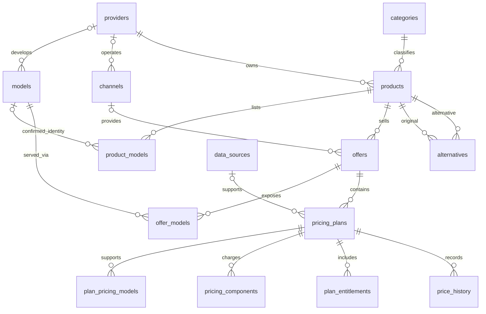

# OpenPriceHub P1：D1 增量适配方案

版本：v1.1.0

日期：2026-11-06 UTC

状态：数据库路线已确认采用 D1；本文为适配设计，具体字段及 Migration 尚待审阅。

## 1. 决策与版本关系

后续继续使用 Cloudflare Workers + D1/SQLite，保留 `env.DB`、现有 API 和前端 UI。不引入 PostgreSQL、Supabase、Hyperdrive 或双库写入。

本文替代 `p1-data-standard-v1.0.0/` 中的 PostgreSQL 选型、物理类型、事务实现及迁移路线；旧稿保留为历史业务概念参考，不能直接用于生成 D1 SQL。旧稿全量字段字典不是第一版建表清单。

本次只更新文档，不生成或执行 Migration，不修改数据库、服务或 UI。确认数据库路线不等于已确认具体 DDL。按原 P1 步骤，完整增量字段字典与迁移方案确认后再生成 Migration。

## 2. 第一版范围

| 模块 | D1 适配决策 | 延后内容 |
|---|---|---|
| 分类、产品、服务商 | 复用 categories/products/providers；保留原 ID 和 API 字段 | 没有真实多分类需求时不先建全部多对多分类表 |
| 模型身份 | 复用旧 models；新增可空开发方关联；保留 provider 文本原值 | 自动拆分模型家族、版本、别名 |
| 产品—模型 | 保留现有 product_models 名称记录及 legacy_model_id；经人工确认后建立关联 | 不把名称记录直接转换成确定的模型身份 |
| 渠道、Offer | 新增 channels；offers 增加可空 channel_id；新增 offer_models 显式关联已确认模型 | 无证据的版本级渠道覆盖 |
| 套餐与模式 | 复用 pricing_plans；增加套餐—计费模式关联；原 pricing_models JSON 作为兼容输出 | 不为每种计费方式建立独立套餐表 |
| 价格与权益 | 复用 pricing_components；增量设计精确金额、单位、适用条件及 plan_entitlements | 通用阶梯、复杂组合优惠和规则编辑平台 |
| 来源和历史 | 复用 data_sources/price_history/catalog_revisions；补充新价格发布记录和可追溯来源 | 不重写旧历史，不补造生效日期 |
| 属性、标签 | 先复用 product_feature_attributes；只为实际筛选需求增加类型化字段/模型属性 | 全量通用 EAV、标签管理平台 |
| 平替 | 复用 alternatives 定向关系及现有双向查询索引 | 无数据依据的质量评分或综合排名 |
| 需求入口 | 类型化配置及白名单条件复用统一查询、计价服务 | discovery/matching/ranking 全套动态配置表 |
| 数据管理 | 复用 data_sync_logs，补充审核和身份映射记录 | 多级审批工作流 |

七种计费模式为 Free、Monthly、Annual、Pay As You Go、Credit-based、Usage-based Package、One-time Purchase；旧记录存在 Freemium 时保留原值并明确其免费增值语义，不强行丢弃或自动当作零费用。

五类数据为图片、视频、TTS、音乐、LLM/API。旧 audio 分类不自动归入 TTS 或音乐；旧 text 需确认实际业务含义后映射。新增类别必须同步处理旧 models 的类别 CHECK，不能只更新 categories 字典就认为兼容。

## 3. 增量关系图

下图表示拟议业务关联，不表示已经执行的结构。问号关系允许未知；旧表约束不会在本轮变化。

Product、Model、Provider、Channel 独立；不要求每个产品都必须已知底层模型。模型版本只在有实际版本证据和比较需求时扩展。

## 4. D1 类型和价格标准

| 旧设计 | D1 约定 |
|---|---|
| uuid | TEXT ID；保留所有旧 ID，新 ID 由应用生成，不全库换 UUID |
| timestamptz / date | TEXT；新写入采用统一 UTC ISO 8601 毫秒格式/日期格式；旧 CURRENT_TIMESTAMP 原值保留并在读层归一，不混格式直接排序 |
| boolean | INTEGER，CHECK IN (0,1)；未知可 NULL，不默认伪造 false |
| numeric(30,12) | 新精确价格字段使用规范十进制 TEXT；Worker 精确十进制计算；原 REAL 保留兼容但不作为新计算权威 |
| jsonb | 必要扩展使用 TEXT + json_valid CHECK + Worker 结构校验；核心金额、币种、单位、关系独立字段 |
| enum | TEXT + CHECK，或已有实际配置需求的字典外键 |
| schema / sequence | 不引入 oph schema；使用现有表空间和显式业务 ID/版本号 |

十进制约定：不接受指数表示、NaN、Infinity；最多 30 位数字、12 位小数，非负价格；超精度拒绝或进入待审，不能静默截断。单位数量和费率同样禁止经 Number 中转。具体精确计算实现及依赖在代码阶段选定并测试。

旧 REAL 不能恢复已丢失精度。保留原始数值与来源，缺少原始十进制证据的导入值标记为 legacy approximation，不把浮点字符串转成“已核验精确价格”。SQL CAST 为 REAL 不能用于最终金额计算或精确排名；小数据量候选先在 SQL 按维度过滤，再由 Worker 精确排序并统一分页。未来数据量增大再设计经溢出验证的可索引数值表示。

金额必须同时携带原币种、单位、每计价单位数量、计费周期、适用条件及来源。比较至少匹配币种、维度、模型适用性、质量/分辨率、周期和限制；不把月费、积分费和每次费用混排。

计算结果分别返回预计消耗成本、实际购买金额、剩余额度、有效单位成本；无法计算返回原因而非 0。年付可展示月均，但保留实际年付金额；套餐按购买数量取整；积分跨供应商不可直接换算；文本字符、音频分钟、歌曲和 generation 不自动互换。

## 5. 约束、索引和发布一致性

- 保留旧 PK、FK 和 ID；新 FK 建索引。新可空字段允许历史记录未解析，不立刻收紧旧数据约束。
- `channels` 使用稳定 ID；可选 slug 在非空时唯一，不按显示名去重。
- `offer_models` 建 UNIQUE(offer_id,model_id)，并建立 model_id 反向索引；未知映射不写占位模型。
- `plan_pricing_models` 使用复合主键 (plan_id,pricing_model_code)，反向筛选索引按真实查询增加。
- `plan_entitlements` 使用 UNIQUE(plan_id,entitlement_key)，额度、单位和周期明确；未知额度不能默认为无限。
- 历史新增写入使用唯一幂等键；日期不作为唯一键。原 price_history 继续可读，新增版本记录的具体落表方式在完整字典中明确。
- SQLite UNIQUE 的 NULL 语义不同于旧稿 PostgreSQL NULLS NOT DISTINCT；需要明确的非空业务键或部分唯一索引，不能机械翻译旧稿。
- 普通 CHECK 只验证当前行。关系存在使用外键，跨表发布条件使用受控写入口及必要触发器，不设计 PostgreSQL 延迟约束触发器。
- Worker 继续使用 prepare/bind 和 batch。D1 batch 提供事务回滚，但不能把分开的多个 API 调用描述为同一事务。
- 一次发布的当前投影、历史事件、catalog_revisions、审核日志应在同一 batch 中完成；并发修改使用版本条件和唯一幂等键。条件 UPDATE 影响 0 行不会自动让 batch 失败，需设计能导致约束失败的冲突守卫并实测，避免历史已写但当前价格未更新。
- 大批量导入分批暂存，验证后用小型原子发布切换可见版本；不能声称多个 batch 整体原子。检查 D1 语句、参数、执行时间限制。
- 发布后的历史不允许业务接口修改或删除；需要在 D1 验证相应触发器/写路径保护。来源新观测不能覆盖旧证据。

当前目录读取依赖 catalog_revisions 快照；第一版维持该公开读契约，结构化数据与快照通过唯一发布路径保持一致，不同时开放两套独立写入口。

依据：[D1 Worker API](https://developers.cloudflare.com/d1/worker-api/d1-database/)、[D1 外键](https://developers.cloudflare.com/d1/sql-api/foreign-keys/)、[D1 SQL](https://developers.cloudflare.com/d1/sql-api/sql-statements/)。这些能力说明不代表本项目相关设计已经测试通过。

## 6. 兼容与迁移路线

1. 只读盘点实际目标库：DDL、行数、FK、重复键、孤立记录、来源覆盖和未解析身份；本地快照不能当作生产基线。
2. 完成第一版 D1 增量字段字典、索引、旧新字段权威关系及数据映射清单，再提交审阅。
3. 确认后在现有 migrations/ 后追加 Migration；不改写 0001—0004，不运行初始化或种子脚本覆盖现有库。
4. 在隔离 D1 本地副本验证 Migration 和旧 API；再验证隔离远端 D1 的运行行为。普通 SQLite 测试不能替代 D1 集成测试。
5. 数据回填采用稳定映射和幂等批次；不能确认的产品/模型/套餐保持原记录，加入待审，不强建关联。记录输入数、成功数、待审数、失败数及原记录引用。
6. 新旧字段并存期间明确单一写入权威。兼容 API 保持字段、ID、数值语义；精确计算内部采用字符串，不无预告改变旧 API 数值类型。
7. 生产变更前完成写接口鉴权、参数校验、权限负向测试、备份恢复演练和数据核对；目标环境、备份与部署授权明确后才执行远端操作。
8. 回滚优先恢复兼容代码，保留新增表/列与历史；新写入发生后不能直接回放旧备份而丢失新数据。不使用 DROP 作为常规回滚。

旧价格/身份样本的核验状态不升级。审核日志记录原表/ID、目标 ID（可空）、处理状态、理由、服务端审核者和时间。该清单是数据管理记录，不是臆造关联的工具。

## 7. 涉及文件和接口

| 范围 | 后续可能涉及 | 原则 |
|---|---|---|
| DDL | migrations/ 新增文件；scripts/migrate.mjs 及 bootstrap 只审查兼容性 | 保留 D1 迁移机制，先检查 adoption 对目标库影响 |
| 数据写入与快照 | src/shared/catalog/persistence.ts | 保留公开快照契约，统一原子发布和审计 |
| 数据类型和计价 | src/shared/catalog/types.ts、logic.ts；src/worker/utils/calc.ts | 增量类型、精确数值及条件比较；先测试旧计算器行为 |
| API | src/worker/routes/catalog.ts、prices.ts、models.ts、platforms.ts、admin.ts、submit.ts | 保留 API；先堵住写接口鉴权缺口；修复审核流程前先补测试 |
| Worker 入口 | src/worker/index.ts、env.d.ts | 保留 env.DB，无 PostgreSQL 驱动或连接池 |
| 部署 | wrangler.toml | 不切换数据库；生产密钥不得使用仓库占位值；真实环境尚需确认 |
| UI | 当前页面、导航、手动比较器 | 本阶段不改布局、不撤销功能，不自动接入历史扩展 UI |

## 8. 验收门槛与当前结果

验收需包含：迁移前后逐表数量及原记录内容核对、外键检查、未解析映射统计、旧 API 合同回归、失败发布原子回滚、并发发布冲突、幂等重试、历史不可覆盖、鉴权负向测试。

五类计价测试分别覆盖：图片分辨率、视频时长/质量、TTS 字符/分钟不混算、音乐 song/generation 区别、LLM 输入/输出/缓存 token 分项。跨币种、跨积分池、无来源/过期规则、未知额度必须产生明确限制；年度预付、包数取整、剩余额度和超额规则单独断言。

当前结果：已阅读现有 D1 schema、迁移脚本、配置及文件结构，完成适配设计。未生成 SQL，未运行数据库迁移、计价测试或 D1 集成验收；没有 PostgreSQL 验收结果可沿用。文档检查不等于功能通过。
