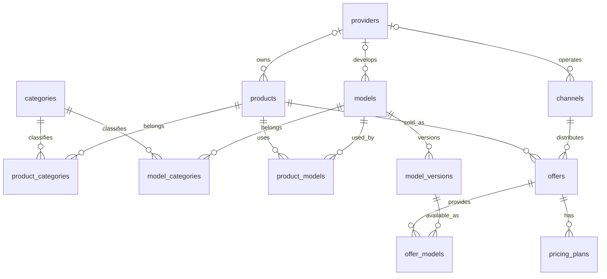
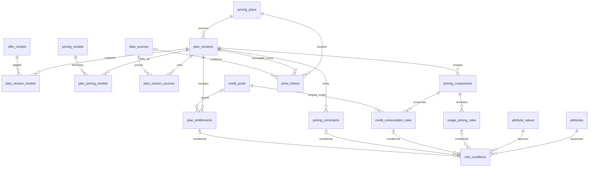
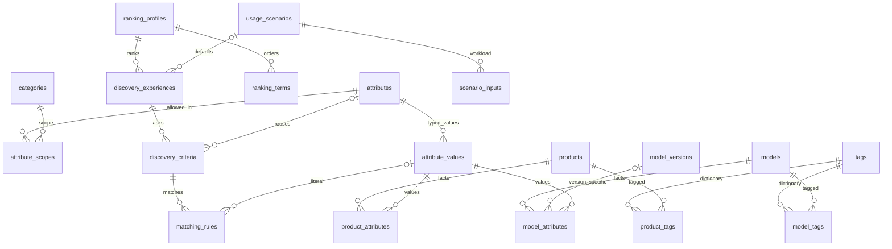
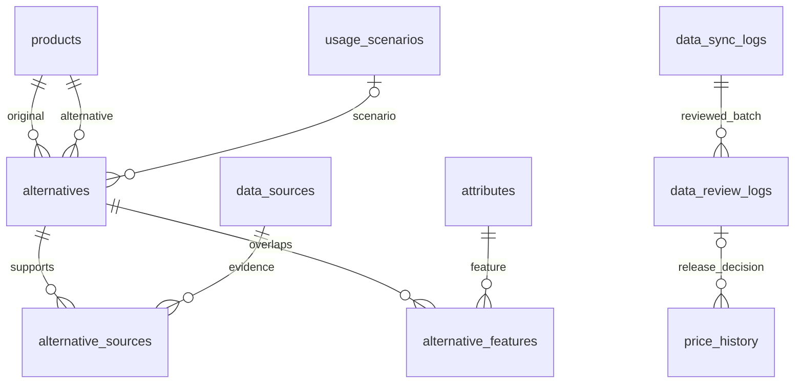

# OpenPriceHub P1：数据库重构与统一数据标准

> 路线更新（2026-11-06）：后续采用 Cloudflare D1。本文为历史 PostgreSQL 草案，不再作为实施依据；请以 [D1 适配方案 v1.1.0](../p1-d1-adaptation-v1.1.0.md) 为准。

版本：**v1.0.0（设计待确认）**

日期：2026-11-06 UTC

状态：完成步骤 1—4 的设计交付；**尚未生成或执行 SQL Migration**。

## 交付清单

1. 本文：实体复用、业务边界、新版 ERD、计价与发现入口契约。
2. [完整字段字典](data-dictionary.md)：所有拟建/演进实体、字段类型、空值、默认与关联。
3. [唯一约束与索引](constraints-indexes.md)：约束、跨表校验、历史保护和查询索引。
4. [迁移方案与验收矩阵](migration-validation.md)：迁移前基线、映射、分批方案、回滚、查询与属性测试设计。

本轮只新增设计文档；不修改应用代码、旧表、数据或部署。SQL Migration、迁移后对账、实际查询和属性测试结果将在确认且目标数据库可用后交付，不以设计样例冒充执行结果。

## 1. 数据库决策

现有运行库为 Cloudflare D1/SQLite，Worker 使用 D1 prepare/batch API。此次要求 PostgreSQL 原生类型与 JSONB，因此推荐：

- 目标为 **PostgreSQL 15 或更高版本**，具体主版本及托管位置待确认；可以托管于 Supabase，但不将 Supabase Auth 等服务引入核心数据模型。
- 首先建立独立的 PostgreSQL 测试数据库，业务表放在 `oph` schema。当前 D1、3001 服务和 UI 继续运行。
- 不将 PostgreSQL DDL 放进现有 D1 `migrations/`，不调用现有 `db:migrate` 执行目标库迁移。
- 复用现有实体语义和可迁移记录，不复制多套“产品/来源/价格”业务。D1 与 PostgreSQL 是迁移期间的源与目标，不是长期双主库。
- 在 PostgreSQL 对账通过前不切换应用读写。Worker 数据适配与读写切换是独立确认点。
- 若决定继续使用 D1，需要另出 SQLite 约束/类型方案；不能声称 D1 已满足 PostgreSQL 字段及 JSONB 要求。

## 2. 现有实体复用决策

| 目标实体 | 当前情况 | 处理方式 |
|---|---|---|
| categories/products/providers/offers | 已有 | 延续实体与稳定映射，拆除混合服务商名称；用分类关联支持多类别 |
| models | 旧库已有 6 行 | 迁入统一模型实体；来源和开发方不清楚时保持待确认 |
| model_versions/channels | 缺失 | 新增；版本不能从产品名称猜测，渠道与开发方分离 |
| product_models | 已有名称型记录 | 演进为产品—统一模型的关联，不再每产品复制一个模型 |
| pricing_plans/components | 已有 | 稳定套餐身份 + 不可变发布版本；结构化组件和规则 |
| plan_entitlements/usage_pricing_rules/credit_consumption_rules/pricing_constraints | 部分在 JSON 中 | 将已知字段拆为关系表，未知含义留在归档/待审队列 |
| price_sources | 当前 data_sources 已实现相同概念 | **继续使用物理表 data_sources**，逻辑名称 price_sources；只读同名视图可用于 API 文档，不另建第二张来源业务表 |
| price_history | 已有 19 行 | 延续追加式审计，引用不可变套餐版本；旧历史原文完整归档 |
| attributes/attribute_values/产品与模型属性 | 只有 product_feature_attributes | 演进为类型化字典和值关联；原功能键映射为属性，不根据描述猜值 |
| tags/product_tags/model_tags | 缺失 | 新增统一标签与关联；标签不承载价格或核验事实 |
| discovery_experiences/criteria/scenarios/matching/ranking | 缺失 | 新增配置层，与计价规则分离 |
| alternatives | 已有定向关系 | 保留方向；关系依据结构化，不存固定省钱结论 |
| data_sync_logs | 已有 | 扩展批次、幂等、校验计数 |
| data_review_logs | 缺失，审核记录分散 | 新增追加式人工决策日志 |
| catalog_revisions | 已有公开快照 | 保留源归档；目标库规范化版本为权威，旧格式快照改为兼容输出，不能反向覆盖新表 |
| platforms/plans/rules/submissions/catalog_submissions/affiliate_links | 旧业务 | 原库不删；保留可追溯映射与旧 API 合同，用户提交/商业推广不纳入客观排名 |

辅助关联表（产品分类、模型分类、Offer 模型、版本模式、来源关联等）是满足多对多和完整性所需，不为每个筛选场景建表。现有旧表不会在本阶段执行重命名或删除。

## 3. 业务边界

- **Product**：用户认识的工具/应用/商业产品。可使用多个模型，所有者是 Provider。
- **Model**：技术模型家族/身份。开发方是 Provider，不等于收费服务商。
- **Model Version**：固定发布版本或明确标识的可变别名；可变别名必须标注，不能伪装不可变版本。
- **Provider**：组织/服务主体。开发方、产品所有者、渠道运营方是不同关系角色。
- **Channel**：具体购买/调用渠道（官网应用、官方 API、第三方 API、市场等），由 Provider 运营，可关联自有 Product。
- **Offer**：某产品在某渠道的具体售卖/服务入口，带地区与客户分组；通过 offer_models 关联可用模型版本。
- **Pricing Plan**：Offer 下的稳定套餐身份。
- **Plan Version**：套餐在某次发布时的完整价格、权益、约束与来源快照；发布后不可直接修改。

一个模型版本可以出现在多个 Offer/Channel；一个 Channel 可以有多个 Offer、模型和套餐。同一 Provider 可以同时扮演开发方和渠道运营方，但不将两个角色混为同一字段。

不能确定模型身份、渠道运营者、价税或计费语义的数据可以进入 draft，但不能生成确定性的可比价格。

## 4. 新版 ERD

### 4.1 产品、模型与服务渠道

### 4.2 套餐、来源、价格与权益

rule_conditions 四种 owner 外键必须且只能有一个。图中省略 unit/currency/source 的重复外键线，字段字典和约束表为准。

### 4.3 属性、标签与入口配置

### 4.4 推荐与审计

审查日志以批次和稳定业务键标识被审查对象，不能将日志中的键当作替代业务外键。

## 5. 价格标准

### 5.1 计费模式

pricing_models 为字典，初始 code：`free`、`monthly`、`annual`、`pay_as_you_go`、`credit_based`、`usage_based_package`、`one_time_purchase`。

套餐版本与模式多对多，例如 Annual + Credit-based；计费模式不能成为 Product 唯一属性。旧 `freemium` 保留原文，映射为产品商业属性或免费/付费套餐组合，不凭该标签制造免费额度。

价格币种保持原值：所有货币字段关联 currencies；原单位文字、原计量数量与规则依据必须保留。展示换汇属于展示/报价层，不改写原始报价。

### 5.2 单位字典与转换边界

| 类别 | 支持计量 code | 允许转换 |
|---|---|---|
| Image | image、credit | 图片张数直接计量；credit 仅在同一 credit_pool 下换算 |
| Video | video_second、video_minute、video、credit | 同一条件的秒/分钟可按精确 60 换算；video 不能猜时长 |
| TTS | character、audio_second、audio_minute、credit | 1K/1M 用 unit_quantity 表达；字符与分钟不可猜算 |
| Music | song、generation、audio_minute、credit | 歌曲与生成次数不默认等价；有来源的每次输出数量才可换算 |
| LLM/API | input_token、output_token、cached_input_token、request | 每 K/M 由 unit_quantity 表达；输入/输出/缓存角色不可混合排序 |

units 存维度、同维度标准单位和精确比例；`credit` 额外要求 credit_pool。不同厂商积分不能直接排序。字符计数方式、输入/输出角色、模型版本、分辨率、时长、质量均进入比较条件。

### 5.3 四类结果明确分开

1. **预计消耗成本 consumed_cost**：实际消耗量按适用规则计价；订阅分摊需要明确分摊条件，否则为 unknown。
2. **实际购买金额 purchase_cost**：为覆盖该用量所需支付的固定订阅、整包购买、最低充值和超额款；展示实际支付周期和年付预付款。
3. **剩余额度 remaining_entitlements**：逐权益/积分池输出余额和到期时间，不把不同池余额相加。日额度不直接当月额度。
4. **有效单位成本 effective_unit_cost**：指定实际购买金额 / 已交付且有用的同类输出数量；输出量为 0 时无定义。不能把订阅价除以理论最大额度冒充真实单位成本。

输出契约：金额为十进制字符串、币种、报价时间、计算周期、版本 ID、使用的组件/规则/来源 ID、以上四项、比较键、限制和 unknown 原因。不为缺字段输出 0。

比较键至少包含：币种、用量向量、类别/能力、模型或明确的替代关系、质量/分辨率/时长、计数口径、地区/价税、时间周期和权益重置条件。LLM 比较输入+输出+缓存的完整用量，不比较单一输入单价后称最便宜。

### 5.4 条件与规则选择

- 同一组件可以有多个条件化规则；同组条件 AND，多个 group_no 之间 OR。
- 常用参数都使用 attributes + 类型化 attribute_values；仅特殊计价表达式放 `special_rule` JSONB，必须含 schema_version 和白名单操作码，禁止任意脚本/SQL。
- 同一 charge_group、模型与请求参数若命中多个互斥方案，先按明确 priority；同优先级重叠返回 ambiguous，禁止静默双重收费。
- 阶梯价格采用半开区间 [lower, upper)，区分 graduated 与 volume；不能把同一批用量按两种单位再次计费。
- 权益通过 charge_group/model scope 绑定消费；有分辨率限制的免费额度不能用于其他质量档。
- 同月重复购买、最低购买量、按次向上取整、年度支付、额度过期都属于价格语义，不能由排序入口临时改变。

## 6. 入口与底层解耦

入口配置链：`discovery_experiences → discovery_criteria → matching_rules → ranking_profiles/ranking_terms`。

- criteria 定义输入控件、属性/固定字段/成本指标、硬性条件或偏好条件；可复用已有 attributes。
- matching_rules 只使用白名单 operator 和类型匹配的值。硬条件未知默认不能通过；偏好未知不给分且暴露缺失数据。
- 排序只使用客观字段、同口径报价结果和明确偏好；佣金、赞助金额不在允许的 metric_code 中。
- 新入口不生成新产品表或新价格表，也不修改计算公式。例：“短视频配音”是 voice 属性+预算+用量配置，不是 voice 专属报价表。
- 配置复用已有操作码时无需改引擎；遇到真正全新的计价语义仍需增加经过测试的规则操作码，不能承诺任意 JSON 规则零开发。
- 一个入口/排序配置发布后不可改写其版本；改配置生成新版本，便于复现当时使用的匹配/排序配置；完整推荐重放还需当时事实与请求快照。

## 7. 历史保护

- pricing_plans 为稳定身份；plan_versions 及其组件、规则、权益、来源集发布后不可 UPDATE/DELETE。
- price_history 为追加事件：publish、replace、withdraw。有效时间 effective_at 与录入时间 recorded_at 分离。
- 在时间 T 查价：按计划取 effective_at≤T 的最新事件，再判断是否撤回、过期或来源不足；新版过期不能回退到更老报价。
- 更正旧价格追加新版本和新事件，supersedes_history_id 记录被更正事件；不直接覆盖旧历史。
- draft 可编辑但必须留下审核日志；正式发布须在单事务中锁定套餐、验证规则、冻结版本并追加事件。
- 金额不能使用浮点进行新计算。源库 REAL 转 decimal 无法恢复原来已经丢失的精度，保留原表示和来源说明，禁止虚构更多有效数字。

## 8. 待确认范围

请确认以下具体方案后进入步骤 5：

1. 采用 PostgreSQL 15+ 独立测试库作为 P1 目标，D1 继续运行，不原地迁生产。
2. 采用本目录 v1.0.0 的实体边界、字段、版本历史和计价契约。
3. 首次批准只生成目标库 Migration 与测试/迁移工具；在指定隔离测试库执行，不自动切换线上 API。
4. 模型/开发方/渠道身份无法证明的记录保留待确认与原档，不从合并名称或历史 Mock 自动推定。

## 技术依据

- [PostgreSQL 约束文档](https://www.postgresql.org/docs/current/ddl-constraints.html)：唯一约束、外键和 CHECK 的职责不同；跨表事实不能依靠普通 CHECK 校验，使用关联外键或事务/约束触发器。
- [PostgreSQL 数值类型](https://www.postgresql.org/docs/current/datatype-numeric.html)：金额采用 exact numeric，不采用 real/double precision。
- [PostgreSQL JSON 类型](https://www.postgresql.org/docs/current/datatype-json.html)：JSONB 用于允许的扩展，不替代可关联的产品、渠道、单位、价格或来源字段。
