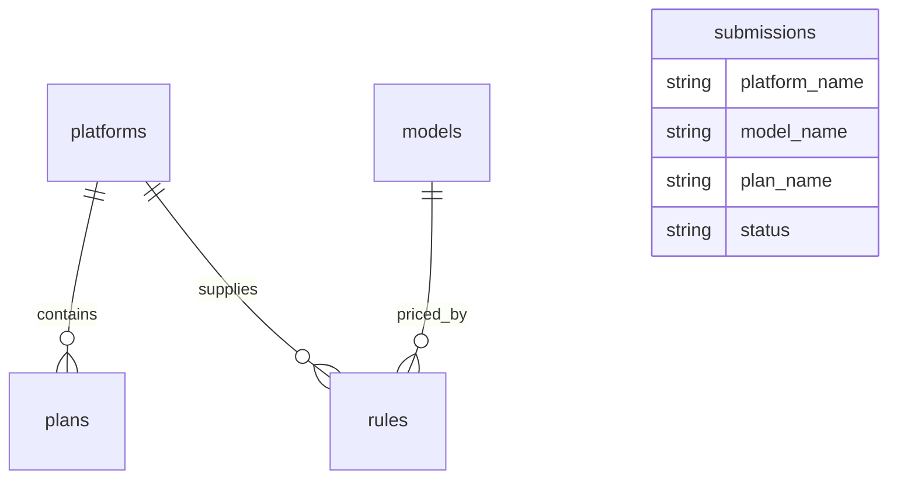
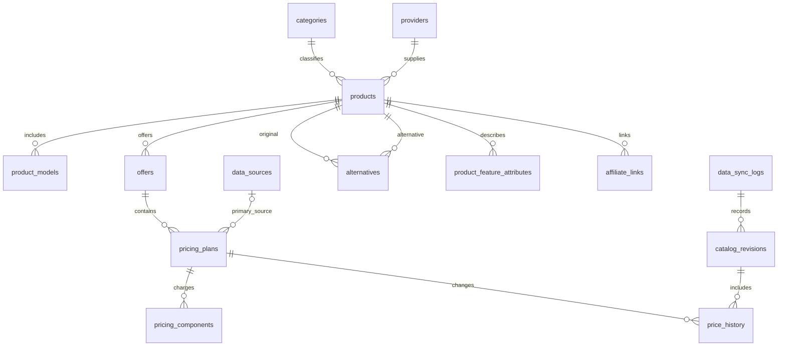

# OpenPriceHub 阶段 0：项目审查与整改规划

| 文档信息 | 内容 |
|---|---|
| 文档版本 | **v1.0.0** |
| 审查日期 | 2026-11-05（UTC） |
| 导出日期 | 2026-11-05（UTC） |
| 阶段 | 阶段 0：只读审查与整改规划 |
| 状态 | 审查完成；等待下一阶段确认 |
| 审查对象 | 当前工作区代码、实际前端路由、本地 D1 结构与现有运行页面 |
| 版本说明 | 本版本号为审查文档版本，不代表应用发布版本或部署版本 |

## 执行边界与核心结论

阶段 0 未修改代码、数据库或部署环境，未执行 Migration，未发起提交、审核、发布或删除请求。本文件是在审查完成后，应用户要求新增的文档导出，不代表已执行整改。

**当前项目具备可用的手动计算工具，但产品目录、数据库和扩展功能尚未形成统一的数据与业务链路。** 页面能打开、组件文件存在，不代表功能已经接入。

状态标记统一使用：

- **已存在且正常**：在本次检查范围内功能与用途一致，不代表无限制或全覆盖保证。
- **已存在但需要优化**：实现存在，但完整性、一致性或维护方式需要调整。
- **尚未实现**：当前用户可访问流程未实现该能力。
- **存在缺陷**：通过代码分析或只读页面检查发现明确问题。
- **需要进一步确认**：缺少外部环境、数据来源或产品决策信息。

## 一、当前系统架构

| 层级 | 实际实现 | 状态 |
|---|---|---|
| 前端 | React 18、TypeScript、Vite 5、React Router 6、Tailwind | 已存在且正常 |
| 页面框架 | 原 Layout、导航、场景卡片、移动底栏 | 已存在但需要优化 |
| 首页与工具库数据 | 直接读取 `src/frontend/mock/`，没有通过数据库 API 获取 | 存在缺陷 |
| 快速／详细计算器 | 本地输入、共享计算函数、localStorage、JSON 导入导出 | 已存在但需要优化 |
| TTS／音乐对比 | 独立表单、独立计算函数、页面内临时状态 | 已存在但需要优化 |
| 后端 | Cloudflare Worker，两套业务 API 并存 | 已存在但需要优化 |
| 数据库 | **Cloudflare D1 / SQLite，不是 Supabase** | 已存在且正常 |
| Supabase | 未发现 SDK、连接配置或 PostgreSQL Migration | 需要进一步确认 |
| 扩展目录模块 | `catalog/` 中保留产品、套餐、平替、审核和 SEO 实现，当前前端未接入 | 已存在但需要优化 |
| 构建部署 | 当前构建为 `vite build`；GitHub Actions 配置了测试、远程迁移和部署 | 已存在但需要优化 |

### 1.1 当前数据链路

```text
首页／工具库 → Mock 数据

快速／详细计算器 → localStorage
TTS／音乐对比 → React 临时状态

Worker API → D1 旧表／扩展目录表
                 ↑
           当前主目录未接入
```

### 1.2 主要目录

```text
src/frontend/
  App.tsx                 实际路由与 Provider
  components/             原 UI、导航、卡片、搜索、比较条
  pages/                  原页面、手动计算、TTS／音乐对比
  data/                   当前 Mock 数据访问与过滤
  mock/                   示例产品、价格更新、指南、赞助
  context/                币种、比较选择
  i18n/                   中英文词典和语言路由辅助
  catalog/                保留但未接入主前端的扩展目录实现
src/shared/
  types.ts                旧业务与工具目录类型
  manualCompare.ts        快速手动计算
  detailedCompare.ts      详细计算的数据组装与兼容
  audioCompare.ts         TTS／音乐手动计算
  catalog/                扩展产品、套餐、计价、来源、SEO 和持久化
src/worker/
  index.ts                API 分发、资源、Sitemap、robots
  routes/                 旧 API 与扩展目录 API
  utils/                  旧计价、验证、响应辅助
migrations/               旧表、扩展表和兼容迁移
scripts/                  构建辅助、迁移、部署、验证脚本
tests/                   计算、目录、迁移测试
```

关键依据：[实际路由](../src/frontend/App.tsx)、[目录数据层](../src/frontend/data/index.ts)、[Worker](../src/worker/index.ts)、[部署配置](../wrangler.toml)。

依赖方面同时存在 npm、pnpm 锁文件，CI 使用 npm；`pnpm-workspace.yaml` 的 `allowBuilds` 仍含说明性字符串，安装行为需要进一步确认。本阶段没有执行安装或依赖升级。

## 二、当前页面 Sitemap

以下 `/:lang` 表示 `/zh` 或 `/en`。

| 路径 | 当前实际内容 | 状态 |
|---|---|---|
| `/` | 跳转中文首页 | 已存在且正常 |
| `/:lang` | 原首页、搜索、分类入口、工具卡片、赞助、更新和指南链接 | 已存在但需要优化 |
| `/:lang/tools` | Mock 工具目录、搜索、筛选、卡片／表格切换 | 已存在但需要优化 |
| `/:lang/tools?category=image` | 图片工具目录 | 已存在但需要优化 |
| `/:lang/tools?category=video` | 视频工具目录 | 已存在但需要优化 |
| `/:lang/tools?category=llm-api` | LLM/API 工具目录 | 已存在但需要优化 |
| `/:lang/tools?category=voice` 或 `category=tts` | 直接显示 TTS 手动对比表单 | 已存在但需要优化 |
| `/:lang/tools?category=music` | 直接显示音乐手动对比表单 | 已存在但需要优化 |
| `/:lang/tools/:slug` | `Coming soon` 占位页 | 尚未实现 |
| `/:lang/compare?tools=...` | `Coming soon`，未消费已选产品完成比较 | 尚未实现 |
| `/:lang/compare/tts` | TTS 手动成本对比 | 已存在且正常 |
| `/:lang/compare/music` | 音乐手动成本对比 | 已存在且正常 |
| `/:lang/calculator/voice`、`/:lang/calculator/music` | 上述两个对比页的别名 | 已存在但需要优化 |
| `/:lang/calculator`、`/:lang/manual-compare` | 快速／详细手动工作区 | 已存在但需要优化 |
| `/:lang/submit` | 表单与价格预览；提交只改变本地状态 | 存在缺陷 |
| `/:lang/guides`、指南详情链接 | 占位页 | 尚未实现 |
| `/:lang/about`、`/:lang/admin` | 占位页 | 尚未实现 |
| 未知路径 | 占位页或回到中文首页，未形成清晰 404 | 存在缺陷 |

`/compare/tts`、`/compare/music`、`/manual-compare` 有无语言前缀的中文跳转入口。

仓库中的 `Platforms`、`Models`、`ModelDetail`、另一套 `Compare` 和 `catalog/pages.tsx` 等页面文件，**不等于当前可访问页面**。原先规划的 `/category/...`、`/pricing/...`、`/alternatives/...` 当前没有接入主路由。

## 三、数据库实际结构与 ERD

### 3.1 本地数据库核对

通过 SQLite **只读连接**检查了本地 D1：

| 数据组 | 本地实际数量 |
|---|---|
| 旧业务表 | 3 个平台、4 个套餐、6 个模型、6 条价格规则 |
| 扩展目录 | 4 个分类、10 个服务商、10 个产品、11 条产品模型记录 |
| 报价体系 | 10 个 Offers、19 个套餐、16 个价格组件 |
| 来源与推荐 | 12 个来源、6 条定向平替关系 |
| 历史与版本 | 19 条价格历史、6 个目录版本 |
| Affiliate | 0 条链接 |

产品状态为 9 条 `verified`、1 条 `pending`；套餐核验日期均为 **2026-10-30**。这只是数据库记录状态，**本阶段没有重新核验厂商价格**。本地外键检查未发现异常。

### 3.2 旧数据库关系



旧 `rules` 没有 `plan_id`，也没有明确的“该模型适用于哪些套餐”关系。`submissions` 使用提交时的名称和字段，不通过上述外键建立业务实体关系。

### 3.3 扩展目录关系



补充说明：

- `providers.legacy_platform_id`、`product_models.legacy_model_id` 提供旧数据兼容关联。
- 多来源、功能属性及部分价格规则保存在 JSON 中，并非全部由关系约束保证。
- 目录读取以最新 `catalog_revisions.catalog_json` 为准；直接修改规范化表不一定改变公开快照。
- `submissions` 与 `catalog_submissions` 是两套提交流程。
- Supabase 若存在于另一环境，需要后续提供只读结构信息；目前不能绘制或推断其 ERD。

依据：[旧表结构](../migrations/0001_init.sql)、[扩展表结构](../migrations/0003_product_catalog.sql)。

## 四、已有功能与实际实现情况

| 功能 | 审查结论 | 状态 |
|---|---|---|
| 首页与导航 | 原视觉结构完整，新增 TTS、音乐入口可用 | 已存在且正常 |
| 搜索 | 子串匹配名称、简介和标签；未统一检索模型、服务商、套餐和平替 | 已存在但需要优化 |
| 搜索状态 | 输入框仅用 `defaultValue` 初始化，URL 变化后可能与结果条件不同步 | 存在缺陷 |
| 目录筛选 | 人群、地区、商用、能力、付费方式可筛选，但依赖 Mock 属性 | 已存在但需要优化 |
| 多套餐 | `Tool.plans` 支持多个套餐；详情和完整比较未接通 | 已存在但需要优化 |
| 多付费方式 | 当前目录以产品级单个 `pricingModel` 筛选，无法准确表达套餐级多方式 | 存在缺陷 |
| 产品比较 | 选择条可选最多 4 个产品，但比较落地页是占位页 | 存在缺陷 |
| 快速计算 | 支持直接单价、积分换算和场景用量 | 已存在但需要优化 |
| 详细计算 | 支持平台、套餐、模型、规则、本地维护和图表 | 已存在但需要优化 |
| TTS／音乐计算 | 支持套餐、额度、超额、年付、整包购买，同币种同单位才计算节省 | 已存在且正常 |
| TTS／音乐保存 | 当前仅页面内状态，刷新或离开后丢失 | 尚未实现 |
| 价格提交 | 实时预览可用，实际提交和附件上传未接通 | 存在缺陷 |
| 指南 | 首页有指南卡片，但没有正文页面 | 尚未实现 |
| 后台审核 | API 和后台组件存在，当前 `/admin` 未接入 | 已存在但需要优化 |
| 历史价格 | 扩展数据库和 API 已有，主目录未使用 | 已存在但需要优化 |
| 自动过期处理 | 未发现按有效期自动降级、下架或重新核验机制 | 尚未实现 |
| 赞助展示 | 有赞助标识和 `rel="sponsored"`；自然排序未读取赞助佣金 | 已存在且正常 |
| 真实赞助关系 | 当前赞助位是 Mock，不能确认真实商业关系 | 需要进一步确认 |
| Affiliate | 表和扩展逻辑存在，本地没有链接，当前页面未形成闭环 | 已存在但需要优化 |

## 五、UI/UX、国际化与 SEO 问题

| 编号 | 问题 | 状态 | 优先级 |
|---|---|---|---|
| U1 | 产品详情、比较、指南等可点击入口最终进入占位页 | 存在缺陷 | P0 |
| U2 | TTS／音乐“分类”进入计算表单，图片／视频／LLM 分类进入产品列表，交互含义不一致 | 已存在但需要优化 | P1 |
| U3 | 英文工具库在 390px 下页面宽度达到 **453px**；排序与视图切换工具条溢出 | 存在缺陷 | P1 |
| U4 | 提交后显示成功，但没有网络提交；截图字段仅保存文件名 | 存在缺陷 | P0 |
| U5 | 英文首页搜索按钮仍为中文“搜索”，赞助 CTA 等也有固定中文 | 存在缺陷 | P1 |
| U6 | 字典缺项自动回退中文，容易掩盖英文内容缺失 | 已存在但需要优化 | P1 |
| U7 | 顶部币种切换、手动工作区目标币种、TTS／音乐结算币种是不同状态，用户不容易理解作用范围 | 已存在但需要优化 | P1 |
| U8 | 当前抽查页面都使用相同 title 模板和固定根域 Canonical | 存在缺陷 | P1 |
| U9 | 英文页面仍继承 `og:locale=zh_CN` 等静态元数据 | 存在缺陷 | P1 |
| U10 | Sitemap 固定列出 8 个页面，遗漏 TTS、音乐；未与实际有效页面统一生成 | 存在缺陷 | P1 |
| U11 | 结构化数据声明了“跨平台价格查询、众包提交”等能力，与当前实际完成度不一致 | 存在缺陷 | P1 |
| U12 | 旧 SEO、新目录 SEO、预渲染脚本并存，但默认构建未接入后两者 | 已存在但需要优化 | P2 |
| U13 | 移动抽屉已有基础结构，焦点管理、键盘操作与读屏仍需专项验收 | 需要进一步确认 | P2 |

证据：[提交行为与截图字段](../src/frontend/pages/Submit.tsx)、[静态 Canonical](../index.html)、[工具库布局](../src/frontend/pages/Tools.tsx)。

## 六、数据模型与价格体系问题

| 编号 | 问题 | 状态 | 优先级 |
|---|---|---|---|
| D1 | Mock 文件明确写着“价格／单位成本为示例”，公开页面却显示官方、已核验、热门等标识 | 存在缺陷 | P0 |
| D2 | “最新价格更新”来自固定 Mock，日期主要是 2026 年 7 月，未关联真实价格变更 | 存在缺陷 | P0 |
| D3 | 不能确认这些价格今天是否仍有效；不能仅凭旧日期断言全部错误，但也不能继续当作最新事实 | 需要进一步确认 | P0 |
| D4 | 当前目录、旧数据库、手动计算、音频计算、扩展目录使用不同分类和价格结构 | 存在缺陷 | P1 |
| D5 | 价格排序直接比较换汇后的 `fromPrice`，没有先限定周期、单位和套餐条件 | 存在缺陷 | P0 |
| D6 | `priceLabel()` 使用 `!fromPrice` 判断免费，可能把未知价格 `null` 当作免费 | 存在缺陷 | P0 |
| D7 | 当前产品只关联一个产品级付费方式，不能准确筛选不同套餐的月付、年付、按量等 | 存在缺陷 | P1 |
| D8 | 旧平台同时承担产品网站、API 服务商等角色；缺少统一的产品—模型—服务商边界 | 已存在但需要优化 | P1 |
| D9 | 旧价格规则与平台下全部套餐组合计算，没有套餐适用模型约束 | 存在缺陷 | P1 |
| D10 | 手动积分计算采用“套餐价÷积分×消耗”，不等同于真实订阅月账单；未统一处理最低购买额、剩余额度和超额 | 已存在但需要优化 | P1 |
| D11 | 快速计算对不同类别场景成本统一排序，并标“当前最低”，不能代表功能可替代 | 存在缺陷 | P0 |
| D12 | 手动计算会累加多个单位项；若同时填写同一服务的每秒和每分钟价格，存在重复计费风险 | 存在缺陷 | P1 |
| D13 | 零价格在提交预览中使用真假值判断，被当作没有填写 | 存在缺陷 | P1 |
| D14 | CNY/USD 使用固定汇率，日期为 2026-06-18；未知币种在目录换算中回退为 1 | 存在缺陷 | P0 |
| D15 | 核验日期与状态已有字段，但没有时效阈值；`verified` 不会随时间自动改变 | 尚未实现 | P1 |
| D16 | 多来源与模型标识部分存于 JSON／字符串，未来跨产品模型去重和引用一致性需要补强 | 已存在但需要优化 | P2 |

关键证据：[价格排序](../src/frontend/data/index.ts)、[价格标签](../src/frontend/components/ToolCard.tsx)、[手动计价](../src/shared/manualCompare.ts)、[汇率处理](../src/frontend/context/CurrencyProvider.tsx)、[固定汇率日期](../src/shared/constants.ts)。

### 6.1 计算正确性结论

- 图片按张、API 按输入／输出 Token、视频／音频按时间的基础算术已经具备。
- TTS／音乐对比有单位与币种隔离，边界比旧目录更清楚。
- **不能据此认定全站成本比较正确**：套餐适用范围、计价周期、重复单位和跨类别排名仍存在问题。

## 七、重复实现与后端缺陷

| 问题 | 状态 | 优先级 |
|---|---|---|
| `Home`、`CatalogHome`、`IntegratedHome` 并存，后两者未接入 | 已存在但需要优化 | P2 |
| 原 Tools 与 CatalogDirectory 两套搜索、筛选、价格展示 | 已存在但需要优化 | P1 |
| 旧 Worker 计算、手动计算、音频计算、Catalog 计算多套规则并存 | 已存在但需要优化 | P1 |
| 快速和详细计算共用 `calculateManualComparison`，这部分已有合理复用 | 已存在且正常 | — |
| 两套提交组件、两套提交表、两套审核流程 | 已存在但需要优化 | P1 |
| 两套后台组件、多个 SEO 实现，文档与当前接线状态容易失配 | 已存在但需要优化 | P2 |
| `/api/platforms`、`/api/models` 的 POST／PUT／DELETE 没有管理员鉴权 | **存在缺陷** | **P0** |
| 旧审核 `/api/admin/submissions/:id` 使用 `split('/')[3]`，实际取到 `submissions` 而非 ID | 存在缺陷 | P0 |
| 旧审核先更新状态，再创建业务数据，缺少统一事务和明确幂等控制 | 存在缺陷 | P1 |
| 旧提交查重使用 `plan_name = NULL` 情形，无法按预期匹配无套餐提交 | 存在缺陷 | P1 |

权限问题仅根据调用链静态确认，**没有通过写入或删除请求验证**。反向代理或外部访问控制是否另有保护，需要进一步确认。

依据：[平台写接口](../src/worker/routes/platforms.ts)、[模型写接口](../src/worker/routes/models.ts)、[审核逻辑](../src/worker/routes/admin.ts)、[提交逻辑](../src/worker/routes/submit.ts)。

## 八、推荐实施顺序与每阶段范围

### 8.1 优先级定义

- **P0**：优先解决权限、事实误导、错误排名、提交假成功和关键断路；先确认范围，再实施。
- **P1**：统一业务与数据契约，接通可用产品流程，完善计算和移动体验。
- **P2**：减少重复实现，完善维护性、关联约束及专项可访问性。

### 8.2 分阶段实施建议

原则：保留当前 UI 和正常功能，先解决真实性、权限和计算问题，再接通产品业务；不重新设计首页，不自动恢复之前撤回的“已核验”展示。

| 阶段 | 工作与优先级 | 文件／组件范围 | 数据库与 API 范围 |
|---|---|---|---|
| 1：纠正高风险行为 | P0：写接口权限、假提交成功、免费误判、错误价格排名、未知汇率 | `Submit`、`ToolCard`、`data/index`、`CurrencyProvider`、Worker 路由 | 旧平台／模型写 API、提交／审核 API；先明确是否需要数据库变更 |
| 2：统一价格契约 | P1：统一分类映射、产品／模型／服务商边界、套餐级付费方式、单位与周期 | `shared/types`、`catalog/types`、三类计算模块 | 复用既有产品／套餐／组件表；只对确认缺失的关联设计增量 Migration |
| 3：接通最小产品闭环 | P1：原列表→详情→选择产品→比较→官方来源；保留手动输入 | `Tools`、详情组件、`CompareBar`、比较页、`App` | 选定一套目录读取接口；明确旧 ID 到新 ID 的映射 |
| 4：完善计算器 | P1：套餐适用性、实际账单、额度、超额、年付；统一不可比提示 | `manualCompare`、`detailedCompare`、`audioCompare` 及页面 | 初期可不增加数据库；后续是否保存 TTS／音乐方案由产品决策 |
| 5：数据管理闭环 | P1：提交、审核、发布、历史、有效期、来源 | 选定的 Submit／Admin 实现、`catalog/persistence` | 合并或适配两套提交流程；明确快照与规范化表的唯一写入通道 |
| 6：UI 细节与 SEO | P1/P2：修复手机溢出、语言一致性、页面元数据、404、Sitemap | 原 Layout／Tools、i18n、SEO、Worker、构建脚本 | 无必要不动业务表 |
| 7：回归与验收 | 验证价格条件、旧数据、导入导出、页面交互和移动端 | `tests/`、浏览器检查脚本、CI | 在隔离测试库验证迁移；部署另行确认 |

阶段 2 应先交付价格数据契约与兼容映射，再批准数据库变更。不能因为仓库已经有扩展 Migration，就默认执行或重新发布。

### 8.3 推荐用户流程


此流程是后续实施建议，不代表当前已经完整实现。

## 九、兼容性风险与待确认事项

| 风险／事项 | 状态 | 建议 |
|---|---|---|
| 旧 Mock slug 与扩展目录 ID 不完全一致 | 已存在但需要优化 | 建立映射，避免详情链接、比较参数失效 |
| 快速／详细计算器使用不同 localStorage 键及 v1 导入格式 | 已存在且正常 | 保护原键和旧格式，升级时提供兼容读取 |
| 统一计算可能改变旧结果 | 需要进一步确认 | 保留历史结果示例，明确“单位摊销成本”和“实际月账单”区别 |
| 两套提交状态含义不同 | 已存在但需要优化 | 明确 reviewed 不等于 published，避免误发布 |
| 快照与规范化表双份数据 | 已存在但需要优化 | 固定发布入口，防止改表后前端不更新 |
| Supabase 是否为未来目标或外部现有系统 | 需要进一步确认 | 本阶段不推定迁移方向 |
| 生产 D1/KV、域名及外部访问控制 | 需要进一步确认 | 当前配置仍含占位资源 ID，不能推断生产状态 |
| 真实赞助、Affiliate 合作及热度来源 | 需要进一步确认 | 没有证据前不能作为真实商业关系或排名依据 |
| 公开页面是否显示核验标签 | 需要进一步确认 | 后台来源与有效期可以保留，不必强制增加前台标签 |
| npm／pnpm、历史脚本与当前路由测试不一致 | 已存在但需要优化 | 统一受支持的工具链和当前验收脚本 |

## 十、本阶段验证范围与限制

- 完成代码、路由、依赖、配置和 Migration 文件审查。
- 完成本地 D1 只读表结构、数量及外键检查。
- `tsc --noEmit` 通过，没有生成构建产物。
- 只读抽查 8 个页面、1440px／390px 两种宽度，共 16 个页面场景；无页面 JavaScript 异常，确认英文工具库存在横向溢出。
- 未重新核验外部厂商价格，未审查远程数据库。
- 未运行写入型 API 检查、构建、Migration 或部署。
- 本报告不以此前阶段的测试数量代替本次审查证据。
- 本文是审查快照；后续代码或环境变化后，应更新文档版本及相应证据。

**阶段 0 到此停止，等待用户确认下一阶段任务。**

## 版本记录

| 版本 | 日期（UTC） | 变更 |
|---|---|---|
| v1.0.0 | 2026-11-05 | 首次导出阶段 0 审查报告，包含架构、Sitemap、ERD、功能状态、问题清单、优先级、分阶段范围、兼容风险及审查边界。 |
