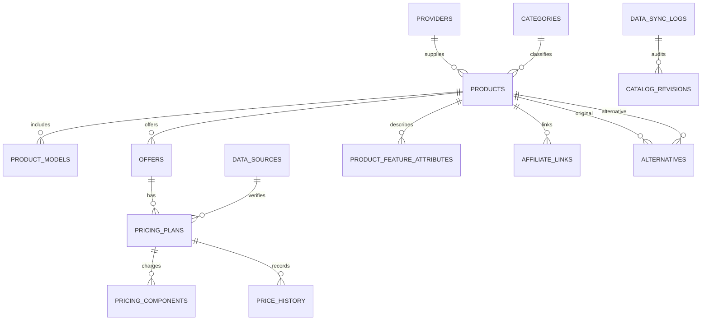

> 当前状态：按用户要求撤回最新增量接入，恢复原首页、UI、工具库和手动计算器。扩展代码与数据保留，未接入当前默认界面。

# OpenPriceHub 产品整改记录

## 阶段 1：现状审计（2026-10-30）

架构：React 18 + React Router + Vite + Tailwind；Cloudflare Worker + D1 + KV。继续复用，不迁移框架。

| 子系统 | 当前结构 / 状态 | 整改 |
|---|---|---|
| 页面 | /zh、/en 首页；/tools 搜索卡片目录；/submit 本地录入预览 | 统一价格决策界面，接入可信目录和真实提交 |
| 占位路由 | /tools/:slug、/compare、/guides、/about、/admin 使用 Soon | 接入详情、比较、方法说明及管理界面 |
| 计算器 | /calculator、/manual-compare；快速/详细两套本地存储计算器 | 保留原数据和功能；新增四类经核验方案计算器 |
| 遗留页面 | Models、ModelDetail、Platforms、PlatformDetail、Compare、Admin 文件存在但未接入路由 | 保留源代码与旧 API，明确兼容入口 |
| 组件 | Layout、SearchBar、Sheet、ToolCard、PriceTable、CompareBar、CompareChart、CostReceipt、Loading、ErrorMessage、EmptyState | 复用外壳、状态和表单风格；新增共享价格表格、来源展示、套餐选择 |
| 上下文 | LocaleProvider、CurrencyProvider、CompareProvider | 保留双语与最多四产品对比；价格排序以原始货币和同维度为准 |
| 当前数据 | frontend/mock 目录；手工 popularity、价格与单位成本缺少可审计核验链 | 从公开决策页面移除未核验排名；新目录记录来源、日期、条件 |
| 数据库 | platforms、plans、models、rules、submissions（0001）；0002 示例数据 | 追加迁移，保留旧表及内容，不把示例转为 verified |
| 后端 | platforms/models/prices/submit/admin API；D1 all() 多处错误按数组使用 | 修正返回值解析；新增目录读取、定向平替、审核发布能力 |
| SEO | React 18 body 内 meta；硬编码域名；旧 sitemap；爬虫模板引用不存在的非哈希构建资源 | 同一页面元数据、规范链接和结构化数据；构建预渲染；真实 sitemap |
| 基线测试 | 3 文件、14 项通过；Vite 构建通过；tsc 存在未使用导入、D1 类型/返回值等历史错误 | 保留14项，增加定价/筛选/关系/迁移/路由/浏览器验证 |
| 环境 | Vite 监听 0.0.0.0:3001；Cloudflare 配置为占位 ID | 本地验证；不宣称已迁移生产数据库或部署云端 |

## 阶段 2：整改清单

- 已有：双语、快速/详细手动计算、本地保存、导入导出、比较选择条、价格录入预览、旧 Worker API。
- 新增：四类目录；套餐级多计费方式；来源核验；详情；定向平替及解释；多产品比较；四类计算器；价格历史；后台审核导入与同步日志。
- 修改：主页、导航、全局搜索、筛选与排序、移动布局、提交交互、SEO、D1 结果读取。
- 新表：categories、providers、products、product_models、offers、pricing_plans、pricing_components、price_history、data_sources、affiliate_links、alternatives、product_feature_attributes、data_sync_logs、catalog_revisions。
- 原表字段保持兼容；providers.legacy_platform_id、product_models.legacy_model_id 允许链接旧记录。新套餐通过 offer 关联产品，计费方式数组属于套餐。
- 价格规则记录货币、结算周期、公开单位、单位数量、配额、超额价格、模型、分辨率/质量/时长限制和来源。未知用 null，不用 0 冒充免费。
- 定向 alternatives 记录 original_product_id、alternative_product_id、similarity_type、feature_match、price_advantage、usage_scenario、recommendation_reason、verification_status、last_verified_at、source_ids；两个方向分别查询，不推导反向推荐。

## 阶段 3：新 Sitemap 与用户流程

英文以无语言前缀路径为主；保留 /en 和 /zh 兼容入口，中文 canonical 用 /zh。原 /calculator 和 /manual-compare 的手动工作区保留。

```text
/
/tools
/category/ai-image
/category/ai-video
/category/ai-voice
/category/ai-tts -> /category/ai-voice
/category/ai-music
/pricing/{free,monthly,annual,pay-as-you-go,credit-based,usage-based-package,freemium,one-time}
/tools/:slug
/alternatives
/alternatives/:slug
/compare
/compare/:a-vs-:b
/calculator/{image,video,voice,music}
/calculator                     # 保留手动工作区
/manual-compare                 # 保留兼容入口
/submit
/about                          # 数据与推荐方法
/admin                          # noindex
```

只将有核验内容的产品、平替、精选对比纳入 sitemap；任意筛选/搜索组合 noindex，canonical 指向未筛选页。无可靠 popularity 数据时使用“已核验工具 / 精选对比”，不伪造热门程度。Best Value 只在有明确使用场景、兼容功能及可算成本时出现。




## 阶段 4：统一 UI/UX 设计规格（先于功能实现）

- 复用现有白色表面、浅灰背景、靛蓝重点色和字体；导航为 Products、Affordable Alternatives、Compare、Calculators；移动菜单及底栏保持可访问。
- 首页首屏使用指定 slogan、简短副标题、全局搜索、四类入口与平替按钮；后续使用紧凑数据模块，不用装饰图片。
- 全局搜索可按产品、模型、提供商、功能、平替名称查询；提示同时显示类别、核验价格、套餐计费方式和免费额度。
- 目录桌面用统一表格（Product / Starting Price / Pricing Model / Free Tier / Cost per Unit / Last Verified / Action）；移动转为有标签的紧凑卡片。
- 筛选全部反映 URL，可分享与回退。先选择月付/年付/某公开计价单位，再做价格区间或成本排序；未知价格排除价格筛选，不混排不同单位。
- 产品、平替、比较页共用标题、面包屑、套餐行、来源区块、比较按钮；核验状态以文字加颜色呈现。
- 计算器显示输入条件、当前方案、候选方案、不可比较原因、公式、月成本、节省及年付实际预付款；默认不推测字符到分钟或积分到生成次数。
- 所有交互包含空态、错误态、键盘焦点、标签、窄屏换行；低价、免费、按量推荐分别说明依据；没有证据的推荐类型明确留空。

## 验收与阶段记录

每阶段记录实际变更与测试。功能与价格核验来源另记于数据文件；运营录入只有通过校验并发布后才影响公开目录。佣金字段不参与定价或排序代码。

### 2026-11-04 最终实施记录

| 阶段 | 已完成变更 | 验证结果 |
|---|---|---|
| 1 当前结构检查 | 记录页面、组件、旧接口与数据库结构，识别手动计算工作区和存储兼容要求 | 保留原计算测试及旧 API 检查通过 |
| 2 整改清单 | 区分可复用、待修改、新页面与新增数据表，价格与推荐逻辑分离 | 对照本文件清单及新目录实现检查 |
| 3 信息架构 | 确定 Sitemap、用户流程及数据库关系，采用增量迁移 | 迁移测试验证旧数据保留；本地复跑无待应用迁移 |
| 4 统一 UI/UX | 首页、四分类目录、搜索、详情、平替、比较和计算器共用布局；移动端紧凑卡片 | 1440px、390px 各 27 个路由检查通过 |
| 5 核心业务 | 套餐级多计费方式、组合筛选、模糊搜索、定向平替、多产品比较、四类成本计算与条件化节省 | 计费、单位、配额、年付、功能限制、定向关系与旧计算逻辑测试通过 |
| 6 SEO 和数据管理 | 独立 metadata、canonical、结构化数据、76 页预渲染、sitemap、noindex、真实 404；管理校验/发布、来源、价格历史与提交审核 | 构建通过；20 项本地 API 检查通过；未知深层地址与 SEO 测试通过 |
| 7 回归验收 | 公网桌面/移动页面及搜索、筛选、比较、计算器、语言切换、原手动工作区回归 | 62 项浏览器检查通过，错误列表为空；72 项自动化测试、类型检查及脚本语法检查通过 |

验证地址：http://161.33.14.187:3001/ 。开发服务监听 `0.0.0.0:3001`，本地 Worker 提供数据接口。此前失败的 `/node_modules/vite/dist/client/env.mjs` 本轮返回 HTTP 200，完整下载 4021 字节；浏览器回归未发现资源加载错误。`git diff --check` 通过。

当前数据覆盖为 10 个产品条目（9 个已核验、Kling AI 官网订阅待核验）、19 个套餐、12 个官方来源、6 条定向平替关系。价格保留实际核验日期，不将本轮测试日期冒充价格核验日期。未核验的候选厂商、未知积分换算、质量评分、热度排名均未补造；无法算出可比成本时明确说明缺失条件。Best Value 仅依据用户所选功能与可比用量条件提供。

后台支持人工核验后的数据校验和发布，并记录日志与价格历史；不声称具备自动抓取并核验所有厂商的能力。本轮数据库和接口写入验证仅作用于本地 D1；Cloudflare 远程部署尚未执行，仍需配置真实资源 ID、正式域名和生产密钥。部署与数据维护步骤见 `docs/catalog-operations.md`。

### 原版本兼容补正（2026-11-04）

用户指出此前改造替换了原页面入口。重新对照 Git HEAD 后确认：原首页和 Tools 组件未删除，但已不在路由中；LLM/API、地区、人群、多维筛选及卡片/表格切换因此不可访问。原手动计算器仍在，但导航入口被弱化。此前“保留已有功能”的结论应据此修正。

本轮增加 `/classic` 原首页与 `/classic/tools` 原工具库（含中文路径），恢复原筛选、视图切换和币种切换；主导航下方提供原首页、原工具库、LLM/API、手动计算器、提交入口。原页面内部工具链接留在原工具库。新版核验目录、平替、比较、四类计算器同时保留。原目录依赖 Mock 数据，页面明确标识历史演示并 noindex，不将其价格、热度和推广标记重新当作已核验事实。

原版产品详情和比较本来就是 Soon 占位页，兼容入口保持这一事实，不宣称已经具备完整旧版详情能力。后续扩充以保留可访问入口及原数据存储为前提，不再用组件文件仍存在代替功能保留验收。
