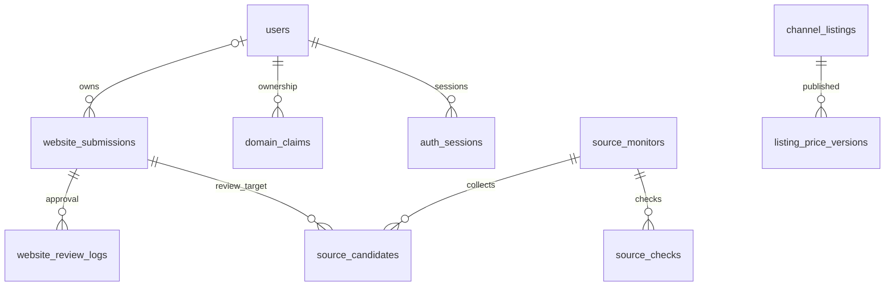

# 三项整改：统一发布数据、权限与运营能力

版本：v1.0.0

日期：2026-11-16 UTC

状态：本地实现与验收；未进行 Cloudflare 远程迁移、部署或生产启用。

## 1. 逐项结果

| 原问题 | 本次实现 | 当前边界 |
| --- | --- | --- |
| 目录与渠道报价没有统一 Repository | `/api/unified/catalog` 聚合两个发布域；主界面共用 Provider；产品、模型、渠道、Offer、套餐、来源及版本有明确契约 | 保留原发布历史，不把含糊名称当作身份；旧数字价格保留 legacy-number 精度标记 |
| platforms/models 写接口缺少鉴权 | POST/PUT/DELETE 均先鉴权，再解析写入；管理员、目录和渠道审核也共用权限服务 | 真实生产账号、HTTPS、远程绑定和全站生产切换仍需部署验收 |
| 每日检查、采集、自动汇率、多管理员、开发者账户、域名验证未实现 | Cron、来源监控、JSON 候选采集、汇率快照、密码会话、角色、所有者关联和 DNS TXT 均已实现 | HTML 只监控变化；没有任意网站通用的价格猜测；新报价仍需人工批准；不声称邮箱已验证 |

本次功能不需要付费邮件服务或新的第三方密钥。外部只读能力依赖 Cloudflare DoH 和 Frankfurter 参考汇率服务；实际域名验证需要网站所有者添加 DNS 记录。

## 2. 统一 Repository

共享契约：`src/shared/unifiedCatalog.ts`。

- `UnifiedApiRepository` 读取一个真实发布视图，`UnifiedProvider` 为首页、工具库、详情、独立比较和平替页提供同一份对象。
- revision 由当前目录版本、当前渠道价格版本及显式身份映射计算；后台发布或映射改变后刷新页面即可获取新视图；页面也在重新聚焦和每 5 分钟检查数据。
- 保留 `catalog_revisions` 和 `listing_price_versions` 各自的不可变历史，通过统一读取层协调；没有把两个写入域粗暴改成互相覆盖的表。
- 标准产品、目录模型、旧独立模型、渠道和 Offer 使用区分命名空间的 ID。未绑定模型的方案显示未绑定，不进入同模型排名。
- 管理员在运营页用明确 ID 关联渠道列表、产品与模型；检查外键、分类及模型归属。不会按名称或邮箱自动合并。
- 未关联的独立开发者产品仍以自己的列表身份展示，关联后归入同一标准产品，不丢失原渠道及价格历史。
- 主流程默认 API 模式，失败显示错误并保留先前已读取版本，不静默用 Mock 假装最新报价。开发可用公开环境变量 `VITE_CATALOG_MODE=mock` 显式切换，Mock 继续用于测试。
- 主界面的搜索包含已关联模型、渠道；计费方式筛选参考产品各个已发布套餐，而非只参考第一种付费方式。
- 价格以原币种及原计价条件展示，空值不当免费。旧价格超过 7 天标记过期，不作为当前起价；没有可靠热度时不提供热度排名，不把不同单位或月费混排。
- 比较页展示统一发布事实与条件；已有模型成本计算器继续处理用户显式输入的工作量。复杂旧规则保留原始 `legacyConditions`，未支持的条件不能被忽略后声称更便宜。

页面：`/:lang/tools`、`/:lang/tools/:slug`、`/:lang/compare`、`/:lang/alternatives/:slug`。独立比较接受 `?products=slug-a,slug-b`，也使用原对比栏选择。平替仅展示有方向的已记录关系，无充分依据时明确为空。

原 `discovery-lab` 保留为显式模拟数据验证入口；真实模式首页主入口转向已发布产品与渠道。现有 UI、手动计算器、JSON、本地存档及音频快捷计算保留。

## 3. 权限与账户

统一实现：`src/worker/services/auth.ts`。

| 身份 | 权限 |
| --- | --- |
| 未登录 | 读取公开数据，提交待审网站；不能写 platforms/models 或审核记录 |
| developer | 管理自己的提交，生成及核验自己的域名挑战；重提仍进入待审 |
| reviewer | 查看与编辑审核草稿；不能发布价格、写旧业务表或管理账户 |
| admin | 发布、身份映射、来源配置、账号创建与停用、分配旧提交所有者 |
| bootstrap | 现有 ADMIN_KEY 的初始化管理员权限；用于创建首批独立账号及应急管理 |

密码用随机盐和 PBKDF2-SHA256（100000 次）保存。服务端只保存会话 token 的 SHA-256，不保存原文 token；会话最长 12 小时，HttpOnly、SameSite=Strict，在 HTTPS 上带 Secure。停用账户、退出和修改密码都撤销对应会话。

创建账号、登录及 DNS 检查有限流。修改密码要求当前密码。Cookie 会话写入检查来源，公开邮箱不是身份凭证。密码不写日志；管理员密钥只保存在页面内存，仍不写 URL 或 localStorage。

首位管理员：

1. 打开 `/:lang/admin/operations`，输入本地配置中的 ADMIN_KEY，加载管理数据。
2. 创建 admin / reviewer 独立账户。
3. 在 `/:lang/account` 登录，后台可不再输入共享密钥，点击“使用账户会话加载”。
4. 停用某账号会立即撤销已有会话。共享初始化密钥仍为高权限凭据，继续通过 Cloudflare Secrets 管理。

本地 localhost/127.0.0.1 允许 HTTP 开发登录。公网账户登录要求 HTTPS；只在明确的开发场景可在 `.dev.vars` 中设置 `ALLOW_HTTP_AUTH=true`，生产生成配置不会启用该选项。

未接入邮件投递，因此不标记邮箱已验证，也不提供基于未验证邮箱的自动找回。用户可自助修改已知密码；生产是否需要邮件验证、邮件找回或 MFA 应作为额外账户策略单独配置，不影响当前域名所有权及价格审核隔离。

## 4. 开发者自助与域名所有权

入口：`/:lang/account`。

1. 注册并登录。登录后提交新网站会绑定当前用户 ID，不按联系邮箱猜测所有者。
2. 在账户页填写与网站完全相同的 hostname，例如 `www.example.com`。
3. 系统生成 `_openpricehub.www.example.com` 的 TXT 挑战，值为 `openpricehub=<随机 token>`，初始挑战有效 24 小时。
4. 所有者在自己的 DNS 服务商添加 TXT，点击检查；后端仅查询固定 Cloudflare DoH，不访问任意验证回调地址。
5. 验证成功后授权窗口为 30 天。更新自己的网站草稿时重新检查该窗口和准确主机名；到期须重新验证。
6. 开发者保存后状态变为 pending；原始提交及已发布价格不变，管理员再次审核后才能发布新版本。

旧匿名提交不会因邮箱相同而被认领，必须由管理员在运营页明确分配用户 ID。DNS 验证证明域名控制权，不自动证明工具质量、厂商授权或官方渠道身份，这些仍由管理员审核。

## 5. 每日检查与自动采集

入口：`/:lang/admin/operations`。

管理员配置 URL、适配器、12/24 小时间隔以及启用状态，必要时指定目标提交 ID。可手动检查或停用来源。

| 适配器 | 行为 |
| --- | --- |
| page-watch | 比较页面 hash / ETag / Last-Modified，记录页面变化；不从任意 HTML 猜测价格 |
| website-json-v1 | 获取与 WebsiteDraft 相同的结构化报价 JSON，校验后形成 source_candidates 候选；不直接发布 |

结构化契约见 `src/shared/websiteSubmission.ts`。厂商未提供此结构时，需要增加明确的厂商适配器；当前不能宣称自动支持所有 AI 工具价格页面。普通 HTML 来源先用 page-watch，发现变化后人工核对。

流程：调度 → 任务租约 → DNS 与 HTTPS 检查 → 限时/限大小获取 → 差异检测 → 候选 → 管理员应用审核草稿 → 管理员明确发布。

- 只允许管理员配置来源，拒绝非公开 HTTPS、敏感凭据查询参数和解析到私有地址的来源；不跟随来源重定向，不传管理员凭据。
- 来源单次响应最多 256 KB，有超时；JSON 继续通过现有价格校验，金额为空不是免费。
- 没变化不产生价格变化；抓取成功时间和核价时间分开。检查失败不刷新成功 hash，也不改变公开报价。
- 每个来源有租约及最小间隔，手动检查可重试；最多读取 30 个启用来源，后续规模化应按实际 Cloudflare 套餐配额拆分任务/队列，当前不是无限爬虫。
- 候选绑定审核基础版本；旧候选不能覆盖管理员已更新草稿；已拒绝/应用的候选不能逆转终态。
- Cron 不自动批准价格；应用到草稿也不会改公开版本。审核和运营日志禁止原地更新/删除。

配置普通 JSON（不要填写任何密钥）：

```json
{
  "cronSchedules": ["0 1 * * *"],
  "automaticFx": true
}
```

这是现有配置的新增字段示意，不是完整配置。一天两次用 `"0 1,13 * * *"`；UTC 01:00/13:00 对应北京时间 09:00/21:00。来源自身仍按 12/24 小时限制执行。旧本地配置缺少这两字段时不会偷偷启用 Cron，需由你补充后按原部署脚本发布。

## 6. 自动参考汇率

- 固定读取 Frankfurter v1 的公开参考汇率，基准 USD；没有新增 API Key。
- 自动任务按开关同步，并复用 12 小时内成功快照；失败保留原值。
- 保存提供方日期、来源 URL、原始报价方向和检查时间，不把检查时间当成市场数据日期。
- 提供方使用 `1 USD = X 目标币种`；计算器契约是 `1 当前币种 = X 基准币种`，后端用精确分数反向换算并支持换基准。
- 日期无效、未来异常、超过 7 天、缺币种或非正数时拒绝，不写入伪造值。
- 计算器可选择自动模式或点击“加载已同步汇率”，加载后同步重算，自动模式每 10 分钟检查已存快照；失败保留上一次有效汇率并提示。用户编辑汇率、来源、时间或基准时回到手动模式。
- JSON v2 导入导出支持 automatic 元数据；原有手动汇率、精确比例、快速/详细模式及备份保留。

2026-11-16 在隔离 Worker 实际同步成功：提供方日期为 2026-11-13，包含基准在内 30 个币种。该时间为参考汇率日期，不宣称为实时市场报价。测试数据与真实快照都未写入项目/生产报价库。

## 7. 数据库关系与字段

新增 Migration：0006_accounts_and_operations.sql、0007_candidate_and_audit_guards.sql。0005 已应用后未改写，修复通过后续版本追加。

| 表/字段 | 说明 |
| --- | --- |
| users | id、唯一 email、password_hash、salt、iterations、role、disabled、created_at |
| auth_sessions | token_hash 主键、user_id、expires_at、created_at；按过期时间索引 |
| auth_limits | bucket、count、expires_at；登录/注册/DNS/密码节流 |
| domain_claims | user_id + hostname 唯一、随机 token、expires_at、verified_at；按 hostname 索引 |
| website_submissions.owner_user_id | 可空用户外键，旧匿名提交默认 NULL，按 owner/更新时间索引 |
| source_monitors | URL、adapter、目标 submission_id、interval_hours、enabled、尝试/成功时间、hash、ETag、Last-Modified、租约、错误 |
| source_checks | source_id、状态、内容 hash、错误摘要、created_at；记录检查，不伪装价格变化 |
| source_candidates | source_id、submission_id、base_version、payload_json、status、created_at；基于版本与内容去重 |
| fx_snapshots | base_currency、rate_date、rates_json、source_url、checked_at；追加快照 |
| operations_audit | actor、action、target、created_at；追加日志 |
| 0007 triggers | 候选终态不可逆；运营日志和审核日志不可更新/删除 |



角色和关联通过 PostgreSQL 之外的 D1 原生字段/外键实现，未切换架构。JSON 只用于快照、复杂类别内容、汇率字典及候选载荷。

## 8. API 概览

| API | 用途 |
| --- | --- |
| GET `/api/unified/catalog` | 统一公开发布数据 |
| PUT `/api/unified/admin/link` | 管理员显式绑定产品/模型/列表 |
| POST `/api/accounts/register`、`/login`、`/logout`、`/password` | 自助账户与会话 |
| GET `/api/accounts/me` | 当前会话身份 |
| GET/POST `/api/accounts/admin/users`、POST `/disable`、`/assign` | 管理员创建、停用账号、分配提交 |
| GET/POST `/api/accounts/domains`、POST `/domains/verify` | DNS TXT 挑战 |
| GET `/api/accounts/submissions`、PUT `/submissions/:id` | 仅自己的记录，验证域名后重提 |
| GET `/api/operations/fx?base=CNY` | 已同步的有效参考汇率 |
| GET `/api/operations/admin` | 来源、候选与日志 |
| POST `/api/operations/admin/sources`、`/disable-source`、`/check` | 来源配置与检查 |
| POST `/api/operations/admin/candidate`、`/fx-sync` | 候选应用/拒绝，手动同步汇率 |

所有管理写操作依赖统一权限；公共读取不会返回密码 hash、会话 token、邮箱或私有审核备注。个人账户接口只返回本人的私有记录。

## 9. 测试与部署边界

- 新增 API/SQLite 集成测试验证鉴权、角色、密码与会话、DNS 令牌、所有者隔离、显式关联、旧价、候选与租约、失败 hash、汇率日期/方向/精度、不可变日志及浏览器 fetch 上下文。
- 新增 `scripts/real-data-check.mjs` 使用独立 Worker + `/tmp/oph-real-data-e2e`，覆盖中文/英文及 1440/390 px。项目本地库不保存测试账号、候选、来源或假价格。
- 290 项自动化测试通过（14 个文件，其中新增整改集成测试 24 项）；新增浏览器检查 52 组和已有完整计算器回归 62 组，共 114 组通过，均无页面 JavaScript 异常；类型检查与构建通过。
- 隔离 Worker 实际通过了公开汇率 API 同步、公开 DNS 查询和来源变化检查。真实自有域名验证仍需要你添加 TXT；Cron 需要你部署配置后在 Cloudflare 验证触发日志。
- 本地迁移前备份 `/tmp/openpricehub-before-0006.sqlite`，旧业务行逐项核对一致、外键检查通过；项目本地无测试用户或来源。
- 本次未执行远程 D1 迁移或生产部署，没有把本地通过等同于生产可直接开放。

部署按原私有配置流程：填好 Cloudflare 参数及 Secret，补充 cronSchedules/automaticFx，运行 cf:check、cf:plan，再由你执行 cf:deploy -- --apply。远程备份、迁移和绑定验证依旧是正式启用前的必要步骤。

参考：[Frankfurter v1](https://frankfurter.dev/v1/)、[Cloudflare Web Crypto](https://developers.cloudflare.com/workers/runtime-apis/web-crypto/)、[Cron](https://developers.cloudflare.com/workers/configuration/cron-triggers/)、[Cloudflare DoH](https://developers.cloudflare.com/1.1.1.1/encryption/dns-over-https/make-api-requests/)。
